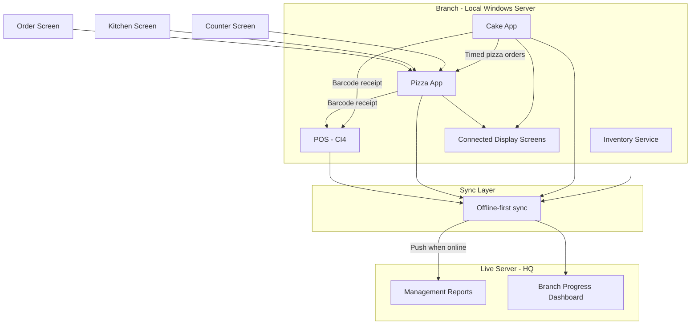
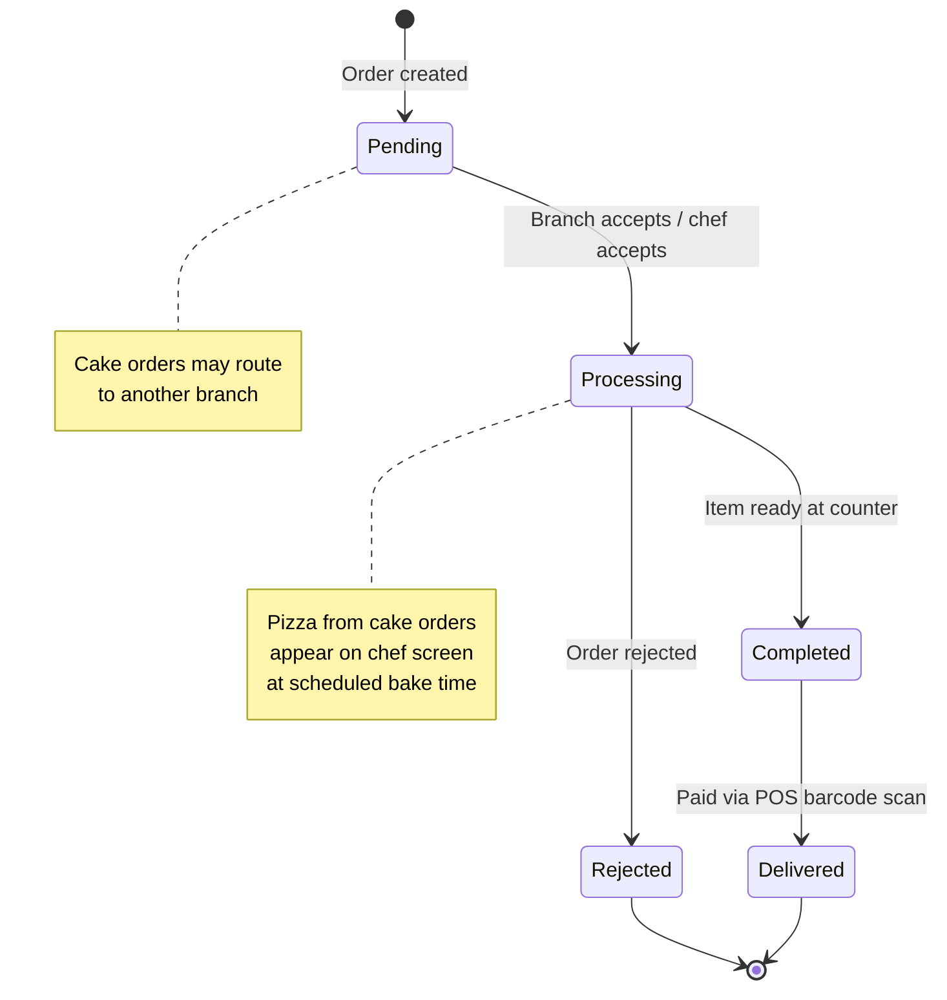

# Tehzeeb Bakers ERP — Building an Enterprise System from Legacy POS

## Overview

**Tehzeeb Bakers** is one of Pakistan's leading bakery brands — **15 branches nationwide** and **more than 30 million in sales over the last two years**. When I joined, their point-of-sale system was the operational backbone of every branch, but it was built on **CodeIgniter 3** and **PHP 5.4**: slow, fragile, and impossible to extend without touching a decade of legacy code.

What started as a POS upgrade became something much larger. Over time, a full **ERP-style platform** was architected around that core — pizza operations, cake and special-order management, inventory across counters, offline branch servers, and a live central server for top management. Each domain became its own service, connected through shared workflows, barcodes, and sync — not a monolith with modules bolted on, but a system designed to grow.

Architecture, application code, integrations, server management, deployments, and branch rollouts were handled end to end.

---

## The Challenge

Before software, Tehzeeb ran on paper.

Pizza orders were written by hand and passed to the kitchen. The chef baked, then walked to the counter to announce the order was ready. During rush hours, orders were lost, duplicated, or mixed up. Customers refused pizzas that were baked for the wrong order. Counter staff had no reliable way to know what was pending, what was ready, or what had already been paid.

Cake and custom orders were worse. Some orders were days or weeks in advance. Some required coordination between branches. Advance payments and remaining balances were tracked manually. Gift boxes, ceremony orders, and custom designs lived in files and phone calls — not in a system anyone could trust.

There was no branch-level inventory visibility, no automated reporting for management, and no way for headquarters to see what was happening across 15 locations in real time.

The business was growing. The tools were not.

---

## Phase 1 — Legacy POS Migration

The first assignment was straightforward on paper and brutal in practice: **upgrade the POS**.

### From CI3 / PHP 5.4 to CI4 / PHP 8.4+

The entire legacy application was migrated from **CodeIgniter 3 on PHP 5.4** to **CodeIgniter 4 on PHP 8.4+**. This was not a version bump — it was a ground-up rewrite of how the application worked:

- Updated **every line of code** to meet CI4 conventions and PHP 8 compatibility
- Resolved **Composer dependency conflicts** across the stack
- Refactored and **optimized legacy flows** that had accumulated years of workarounds
- Redesigned critical user flows for clarity and speed at the counter
- Deployed the upgraded application to production branches
- Delivered **demos of new functionality** to stakeholders as features landed

The POS became the stable foundation everything else would connect to — fast enough for daily operations, modern enough to integrate with new services, and maintainable enough that future work would not require fighting the framework.

---

## Phase 2 — Pizza App and Kitchen Display System

Tehzeeb's pizza department needed more than a better POS. They needed an **operational system** that replaced paper, connected the kitchen to the counter, and tied payment back to the order without manual re-entry.

A dedicated **Pizza App** was engineered and integrated with POS through a barcode workflow.

### How an order moves through the system

Four screens work together — each opens automatically on its assigned display. No dragging windows. No manual setup. Each screen knows its role.

| Screen | Role |
|--------|------|
| **Order screen** | Staff create pizza orders |
| **Kitchen screen** | Chef sees incoming orders on a mini board with three actions: **Accept**, **Reject**, **Pending** |
| **Counter screen** | Shows three live lists: **Completed**, **Rejected**, **Delivered** |
| **POS** | Payment and sale completion |

**The flow:**

1. An order is created on the **order screen**
2. The order appears on the **kitchen screen**
3. When the chef presses **Accept**, the order moves forward in the pipeline
4. When baking is done, the order appears under **Completed** on the **counter screen** — ready for the customer
5. **Rejected** orders stay visible so nothing is forgotten or re-made by mistake
6. When the customer pays at POS, the order moves to **Delivered**

### Barcode integration with POS

Every receipt printed from the Pizza App includes a **barcode**. When the cashier scans it at POS, the full order loads into the cart — items, quantities, and calculations handled automatically. The cashier confirms and completes the sale with a single action. No re-typing. No pricing errors. No mismatch between what was ordered and what was charged.

### Before vs. after

| Before | After |
|--------|-------|
| Paper slips passed to kitchen | Orders flow digitally across four connected screens |
| Chef walks to counter to announce readiness | Counter screen updates automatically when pizza is done |
| Rush-hour chaos and wrong orders | Accept / reject / pending states keep the kitchen honest |
| Manual POS entry | Barcode scan loads the full order into the cart |
| No daily operational reports | **10+ reports** for precise daily insight |

This was the moment Tehzeeb stopped being "a POS with a pizza counter" and started becoming an **ERP with service-oriented architecture** — each app owning a domain, all of them speaking to the same operational truth.

---

## Phase 3 — Cake and Special-Order App

The cake counter handles a different class of problem: **complex, long-running, multi-branch orders** with partial payments and cross-department dependencies.

A **new application and service** was developed dedicated to this workflow — connected to both the Pizza App and POS.

### What this app manages

- Standard cake orders
- **Custom cake orders** (design, flavor, size, delivery date)
- **Gift baskets and gift boxes**
- **Future-dated orders** — customer picks up in three days, a week, or on a ceremony date
- **Large ceremony and event orders**

### Inter-branch order routing

One branch can place an order with another branch to prepare and fulfill it. Every order is tracked across branches through a clear status lifecycle:

**Pending → Processing → Delivered → Rejected**

No phone calls to ask "where is my order?" No spreadsheets. Status is visible in the system at both ends.

### Payment on POS — including partial payments

Like pizza, every cake order is paid through POS via **barcode scan**. But cake orders introduced a harder scenario: **phased payments**.

- Customer pays an **advance** when placing the order
- Customer pays the **remaining balance** when collecting the order
- The system tracks both payments against the same order — who paid what, when, and how much is still due

### Pizza items inside cake orders — timed kitchen display

Some cake orders include pizza — for gift boxes, mixed orders, or custom combinations. That introduced one of the most complex integrations in the entire ERP:

- When a cake order contains pizza, it appears on the **chef screen** with a clear label: **this order is from the Cake App**
- The order does **not** appear immediately. It appears **at the right time** — based on when the customer is scheduled to collect
- Example: if pickup is in two days at 6 PM, the pizza portion surfaces on the chef screen **two days before pickup**, within the hour window when baking must start

The kitchen never has to remember future pizza work. The system schedules visibility.

### Cross-branch pizza sync

When an order is routed to another branch and that order includes pizza, the receiving branch gets the full sync — cake order details **and** the pizza portion on their kitchen screens, with the same timed display logic.

### Gift boxes with pizza by the piece

Some gift box orders require pizza to be **divided into individual pieces**, with each piece placed in a separate box. This is not a standard pizza order — it is a composite order with custom packaging rules. The Cake App handles this as a first-class workflow, not an exception typed into a notes field.

### Reporting

Cake operations demanded deeper reporting than pizza:

- Which **cake flavors sell most**
- When each order was created and by which customer
- **Advance vs. remaining payment** breakdown per order
- Inter-branch transfer status and fulfillment timelines
- Daily and branch-level operational summaries

Tracking every order manually had been impossible. Now it is queryable.

---

## Phase 4 — Inventory and Multi-Counter Management

Tehzeeb's next requirement was **inventory and counter management** across the entire operation — not just pizza and cake.

### Counters covered

- Snack counter
- Biscuit counter
- Grilled items counter
- Pizza production
- Cake production
- All other branch sales points

### What the inventory system tracks

**Raw materials inbound:**

- Chicken, onions, mushrooms, cheese, flour, and every other ingredient received at each branch

**Consumption linked to production:**

- Pizzas baked → chicken, cheese, mushrooms, onions, flour consumed automatically
- Biscuits and snacks produced → raw material usage calculated
- Grilled items → ingredient drawdown tracked

**Remaining stock:**

- What should be left after production and sales
- What each counter sold
- What needs reordering

**Cross-counter visibility:**

- Which counter sold how much
- Which items were baked vs. sold vs. remaining
- Branch-level stock position

The goal was simple to state and hard to build: **every record tracked, every branch visible, no guessing**.

---

## Architecture — Offline-First, Service-Oriented Design

Every application in the Tehzeeb ERP is built on **offline-first architecture**. Branches cannot depend on constant internet connectivity — operations must continue even when the link to headquarters drops.

### Branch layer — local Windows server

Each branch runs a **local Windows server** that hosts:

- POS (CodeIgniter 4)
- Pizza App
- Cake / Special-Order App
- Inventory service
- Other counter applications

All daily operations run locally. Orders, payments, kitchen displays, and inventory updates happen on the branch server without requiring a live connection.

### Central layer — live server for management

A **live central server** receives synced data from all branches. Top management uses this layer for:

- Detailed reports across all 15 branches
- Branch progress and performance
- Consolidated inventory and sales visibility
- Operational oversight without calling each branch individually

### Service-oriented design

Each domain — POS, pizza, cake, inventory — is its own **service** with its own responsibilities. They integrate through:

- Shared **barcode** workflows into POS
- **Status synchronization** across apps (kitchen screens, counter lists, branch transfers)
- **Data sync** from branch servers to the live server

This is not one giant application. It is a coordinated system of services built around how Tehzeeb actually operates. It is not distributed cloud microservices on Kubernetes — it is a **service-oriented architecture** where each business domain operates independently while remaining connected through shared workflows and integrations.

### One-click branch updates

Local systems stay current through an **Update** button in the application. Behind the scenes, **Git** pulls the latest code and updates every app on the branch server — no manual deployment steps at the counter.

### Order and status flow across services

---

## Technical Decisions

Several architectural choices shaped the platform and deserve explicit explanation.

### Why migrate CI3 to CI4 instead of rewriting from scratch

A full rewrite would have meant months without a working POS while 15 branches continued daily operations. The strangler approach — migrating in place to CodeIgniter 4 — preserved business continuity while modernizing the foundation. CI4's namespace structure, improved routing, and PHP 8 type system made the migration painful upfront but paid dividends when integrating new services. Every subsequent application could rely on a stable, well-understood POS core rather than maintaining parallel systems.

### Barcode as the integration bus

Rather than building direct API calls between every service and POS, **barcodes became the integration layer**. Each service prints a receipt with a unique barcode encoding the order ID, items, and pricing. POS scans it and loads the cart. This design choice had several advantages:

- **Decoupling** — Pizza App and Cake App do not need to know POS internals. They produce a barcode; POS consumes it.
- **Audit trail** — Every physical receipt links back to a digital order. Staff can verify what was ordered against what was charged.
- **Offline resilience** — Barcode generation and scanning happen locally. No network call required at payment time.
- **Simplicity at the counter** — Cashiers already scan products. Scanning an order receipt is the same muscle memory.

### Timed kitchen visibility for future pizza orders

The hardest integration problem was not real-time pizza orders — it was **pizza embedded in future cake orders**. Showing a pizza on the chef screen three days before it is needed creates noise. Showing it too late means missed bake times.

The solution was a **scheduled visibility window**: the Cake App calculates when baking must start based on pickup date and time, and pushes the pizza portion to the Pizza App's kitchen screen only within that window. The chef sees future work exactly when it becomes actionable — not before, not after.

### Offline-first by default

Internet connectivity at branch locations is unreliable. Designing for offline-first from the start — local Windows servers, local databases, sync when online — avoided the class of bugs that appear when applications assume always-on connectivity. Every feature was tested with the network disconnected. If it did not work offline, it was not ready.

### Git-powered branch updates

Manual deployment across 15 branches was not sustainable. The one-click update mechanism uses Git to pull the latest code on each branch server. Combined with CI/CD on the central deployment pipeline, this means a fix deployed once reaches every branch through a button press — not a visit from IT.

---

## Operations and Deployment

Infrastructure and delivery were owned end to end — not only application code.

- **Ubuntu servers** — provisioned, configured, and maintained for live and branch environments
- **CI/CD pipelines** — automated deployments so releases are repeatable and safe
- **Branch rollouts** — coordinated updates across 15 locations through the one-click update mechanism
- **Demos and stakeholder walkthroughs** — new functionality shown in context before go-live

Every deployment, every server, every integration — handled end to end.

---

## Business Impact

What changed for Tehzeeb Bakers:

**Operations**

- Paper workflows replaced by connected digital screens across pizza and cake
- Kitchen, counter, and POS stay in sync without staff running between stations
- Rush-hour mismanagement reduced — orders have states, not guesses
- Wrong-order scenarios caught earlier through accept / reject / pending flows

**Business visibility**

- 10+ pizza reports and extensive cake reports — daily, branch-level, customer-level
- Advance and remaining payments tracked per order
- Inter-branch order status visible without phone coordination
- Top management sees consolidated branch progress on the live server

**Scale**

- System designed for **15 branches** with offline resilience
- New counters (snack, biscuit, grilled) and inventory integrated into the same architecture
- Foundation laid for continued expansion without rebuilding from scratch

**Technical foundation**

- Legacy POS on PHP 5.4 / CI3 replaced with **PHP 8.4+ / CodeIgniter 4**
- Service-oriented services around a stable POS core
- Offline-first branch architecture with central sync
- Automated CI/CD and one-click branch updates

---

## Lessons Learned

### Start with the operational workflow, not the database schema

The most successful modules — Pizza App, Cake App — were designed by mapping how staff actually moved through the kitchen, counter, and POS. Database tables followed workflow, not the other way around. When the workflow was wrong, no amount of schema optimization helped.

### Stakeholder demos prevent expensive rework

Showing working prototypes to branch managers and counter staff before full rollout caught UX problems early. A kitchen display that made sense on a developer screen was unusable on a 15-inch monitor mounted above a hot oven. Regular demos kept the system grounded in operational reality.

### Offline-first is a constraint that simplifies architecture

Designing for offline operation forced clear boundaries between local and central data. Branch servers own daily operations; the central server owns aggregation and reporting. This separation made sync logic predictable — push when online, operate independently when not.

### Phased rollout across branches reduces risk

Not every branch went live simultaneously. Starting with one or two branches, validating workflows under real rush-hour conditions, then expanding — this phased approach prevented a single deployment from affecting all 15 locations at once.

### Barcode integration scales better than point-to-point APIs

As more services connected to POS, the barcode pattern avoided an N×N integration problem. Each new service prints a barcode; POS already knows how to scan it. Adding a fourth or fifth service did not require rewriting POS integration logic.

---

## Future Improvements

The architecture is designed for continued expansion. The inventory module represents the next major phase:

### Raw material tracking

Track inbound ingredients at each branch — chicken, cheese, flour, mushrooms, onions, and every other raw material. Link receipts to suppliers, quantities, and costs. Give management visibility into what each branch is consuming versus what it is ordering.

### Production-linked consumption

When a pizza is baked, automatically deduct chicken, cheese, mushrooms, onions, and flour from branch inventory. When biscuits are produced, calculate raw material drawdown. When grilled items are prepared, track ingredient usage. Production and consumption should be linked — not tracked in separate spreadsheets.

### Counter inventory and waste

Each counter — snack, biscuit, grilled, pizza, cake — should show what was produced, what was sold, and what remains. Waste tracking closes the loop: if 50 pizzas were baked but only 45 sold, the system should account for the difference.

### Branch-level stock position

Management needs a consolidated view: which branch has excess flour, which branch is running low on cheese, which counter is overproducing. Automated reorder points and cross-branch transfer suggestions would complete the inventory picture.

### Manufacturing and batch tracking

For items produced in batches — biscuits, snacks, grilled items — track batch sizes, production times, and shelf life. Connect batch production to counter sales so expired or unsold items are visible before they become waste.

These improvements build on the existing service-oriented architecture. The POS, Pizza App, and Cake App already generate the production and sales data inventory needs. The next phase connects that data to raw material tracking — completing the ERP loop from ingredients to sale.

---

## Closing

Tehzeeb Bakers did not need a single app. They needed an **operating system for a multi-branch bakery business** — one that could handle a pizza during lunch rush, a custom cake order three days out, a gift box with pizza divided by the piece, a transfer between branches, a partial payment at the counter, and a management report at headquarters — all without paper, phone calls, or someone trying to remember what was due today.

That is what was delivered: a full ERP, service by service, branch by branch, from a legacy POS migration to a connected platform that runs their business.

---

*Architecture, development, integration, deployment, and server operations — delivered end to end.*
